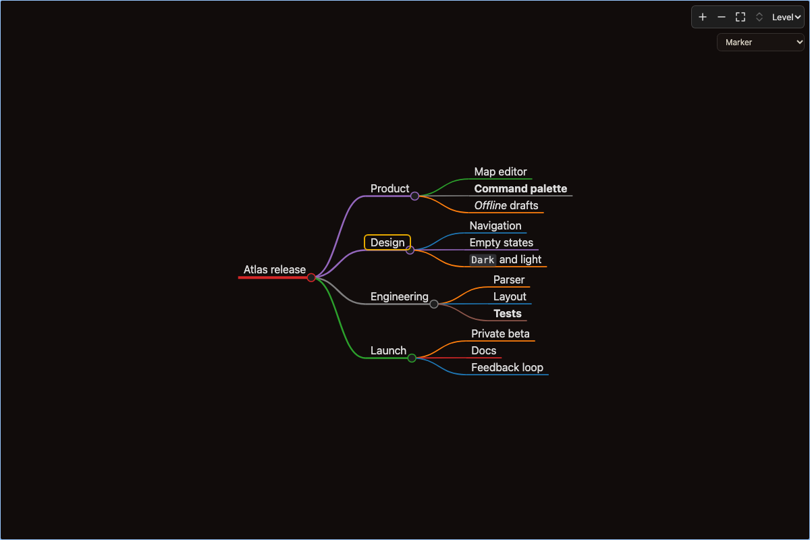
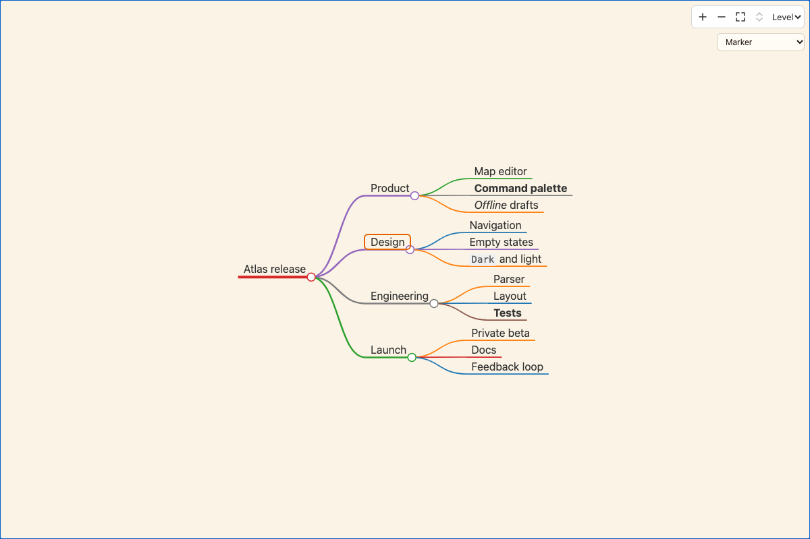
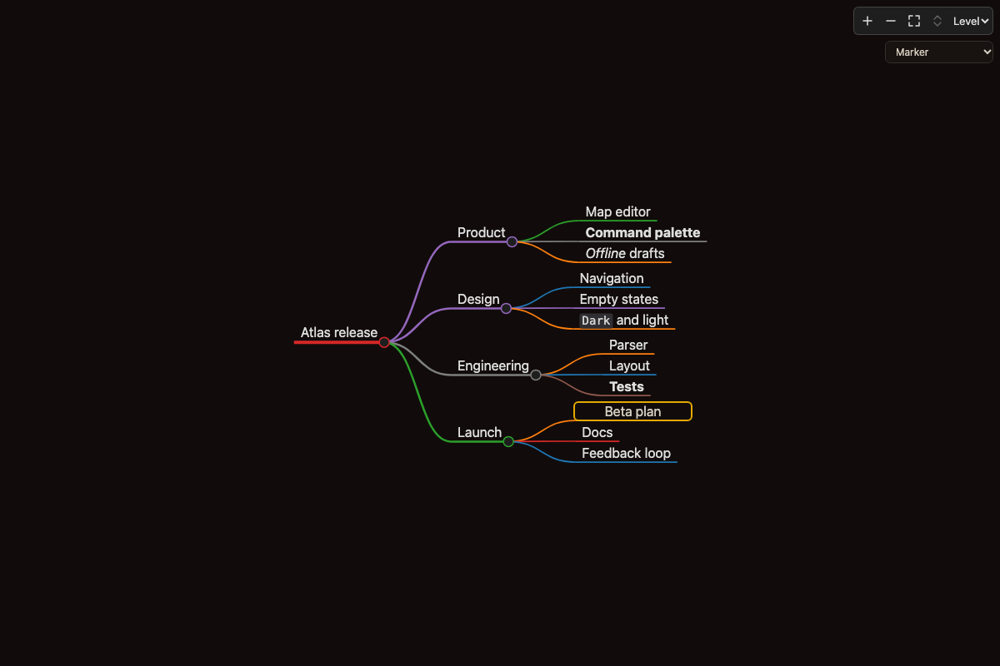

# Markmap for OpenChamber

[](https://github.com/mmospanenko/openchamber-markmap/actions/workflows/ci.yml)
[](LICENSE)

An OpenChamber file editor for Markmap Markdown. Open a `.markmap.md` file in Files and the outline becomes a mind map you can edit in place. Click a node, press Enter or Tab, type. The Markdown file stays the source of truth for Git, agents, and every other editor.

This is an adaptation of the open-source Markmap library, not an official Markmap project. Markmap renders the diagram, layout, view, toolbar, and themes. The editable fork adds the model, commands, and overlay editor that make the diagram editable in OpenChamber.



## What you get

- **Edit on the map.** The map is the editing surface. There is no second Markdown pane and no separate model to keep in sync.
- **Keyboard first.** Enter adds a sibling, Tab a child, Shift+Tab outdents, Delete removes a subtree, F2 or Space edits a label. Arrow keys move the selection; typing a printable character starts a label.
- **Real Markmap.** Rendering, layout, folding, notes, the toolbar, and the viewport come from Markmap. The extension owns only the editing layer and the host contract.
- **Canvas navigation.** The map opens at 100% and is never magnified; a map larger than the window is fitted to it. Scroll or a trackpad surface pans the map; Cmd/Ctrl + scroll zooms around the pointer. Pan speed stays constant at every zoom level, and a wheel burst is applied once per frame.
- **Markdown fidelity.** An edit changes only the Markdown range it touches. Frontmatter, inline Markdown, untouched branches, and line endings survive. New nodes start with an empty label and stay in the tree through a zero-width marker.
- **New files.** An empty matching file opens in an editable state. Type the first label and save; it becomes a heading, and existing frontmatter is preserved.
- **Markers.** A toolbar menu adds status, priority, progress, and flag emoji to a node label. Tasks use ordinary GFM checkboxes, and every marker stays readable in the Markdown source.
- **Theme aware.** The map follows the OpenChamber light or dark theme. Markmap options in frontmatter, such as `theme`, `layout`, `foldLevel`, `colorFreezeLevel`, and `fitMaxScale`, still apply.
- **Safe fallback.** Read-only files render without the editor. Binary input and Markmap failures send the file to OpenChamber's source view, and the original content stays intact.
- **Local only.** No network requests, telemetry, external assets, or stored file contents. The extension asks for no capabilities.

## Use cases

**Plans that live with the code.** Keep a release, architecture, or migration map next to the repository as `plan.markmap.md`. Humans edit it visually; agents read and write the same Markdown with their normal file tools.

**Working sessions.** Edit branches while a discussion is live: rename a workstream, add a child, delete a rejected branch. The map keeps the context visible instead of hiding it in a text outline.

**Agent handoff.** Ask an agent to produce a Markmap file for a plan or investigation, then open it in Files to review, restructure, and correct it without leaving OpenChamber.

**Existing Markmap notes.** Markmap files from other tools open without conversion. Frontmatter and inline formatting are preserved, so the file remains usable outside OpenChamber.

**Outline review.** Fit the map, fold finished branches, and navigate with the keyboard when a document grows past a screen. The source view is one toggle away for exact text edits.

**Read-only maps.** A shared repository can expose a map for viewing without an edit affordance when OpenChamber opens the file as read-only.

## Screenshots

| Light theme                                                                                                  | Editing a label in place                                                                                 |
| ------------------------------------------------------------------------------------------------------------ | -------------------------------------------------------------------------------------------------------- |
|  |  |

## Install

Requirements: OpenChamber 2.7.1 or newer on desktop or web. File editors are not loaded in VS Code or the mobile app.

1. Open **Settings → Extensions**.
2. Paste the Git URL or the install link into the folder, ZIP, or URL field and choose **Add**.
3. There are no capabilities to approve; the host hands the editor one file at a time.

```text
https://github.com/mmospanenko/openchamber-markmap
```

```text
openchamber://extensions/install?url=https%3A%2F%2Fgithub.com%2Fmmospanenko%2Fopenchamber-markmap
```

A folder install runs from that folder and does not update itself:

```text
~/Projects/openchamber-markmap
```

A Git install updates when `version` in `package.json` changes. Open **Settings → Extensions** and choose **Update** on the card.

Remove or disable an older mind-map extension that claims the same file names before installing this one.

## File names

OpenChamber matches editors by file name. This package claims only these suffixes:

- `*.markmap.md`
- `*-markmap.md`
- `*.mm.md`
- `*-mm.md`
- `*.mindmap.md`
- `*-mindmap.md`

A normal `*.md` file stays in OpenChamber's source editor.

## Keyboard and gestures

| Action                                | Input                              |
| ------------------------------------- | ---------------------------------- |
| Select a node                         | Click it                           |
| Edit the label                        | F2, Space, or start typing         |
| Add a sibling                         | Enter                              |
| Add a child                           | Tab                                |
| Outdent                               | Shift+Tab                          |
| Delete a subtree                      | Delete or Backspace                |
| Move the selection                    | Arrow keys                         |
| Fold or unfold a subtree              | Cmd/Ctrl + /                       |
| Undo or redo                          | Cmd/Ctrl + Z, Shift + Cmd/Ctrl + Z |
| Cancel editing or clear the selection | Escape                             |
| Pan                                   | Scroll or a trackpad surface       |
| Zoom around the pointer               | Cmd/Ctrl + scroll                  |
| Fit, zoom in, zoom out                | Markmap toolbar                    |

While a label field is open, Enter commits and adds a sibling, Tab commits and adds a child, and Shift+Enter inserts a line break in a list item. A heading label cannot contain a line break; the editor keeps the document unchanged and shows a notice.

## Markdown format

The file is ordinary Markmap Markdown. Headings and list items become branches, and paragraphs become notes on a node.

```markdown
---
markmap:
  colorFreezeLevel: 2
---

# Release

## Product

- Editor
- **Command palette**

## Launch

- Private beta
- Docs
```

## How it works

The package declares one `contributes.fileEditors` entry. OpenChamber keeps the file, sends the text to the editor, and asks for a snapshot when it saves.

The editor is a single classic IIFE built from `src/` and committed as `editor/main.js`. It uses the published `@markmap/view` and `@markmap/toolbar` 1.1.1 plus the public editable fork of `@markmap/model`, `@markmap/edit`, and `@markmap/edit-dom` in [`vendor/markmap`](vendor/markmap/README.md). The repository contains no custom Markdown parser, layout engine, or serializer.

## Privacy

- The extension makes no network requests and loads no external assets.
- It does not read other files, sessions, or project data. OpenChamber passes it the open file.
- It stores no file contents and has no settings or telemetry.
- The file changes only through the host's save path: `reportFileChange`, `onFileSnapshot`, and `onFileSaved`.

## Development

```bash
bun install
bun run dev
bun run verify
bun run test:acceptance
bun run screenshots
```

`bun run dev` starts the Vite harness at `/dev/`. Append `?map=showcase&theme=light` to open the screenshot map in the light theme.

`bun run verify` runs typecheck, lint, requirement traceability, build, stale-bundle check, reproducible build check, and the 100% coverage gate. Acceptance tests use Playwright against the real Markmap renderer. `bun run screenshots` regenerates the images in `docs/images/` from the same harness and synthetic data.

`editor/main.js` is committed. Run `bun run build` after changing `src/` and keep `bun run check:bundle-fresh` green.

## Quality workflow

The process is documented in:

- [`docs/process/sdlc.md`](docs/process/sdlc.md) — change lifecycle and gates.
- [`docs/process/testing.md`](docs/process/testing.md) — test levels and coverage.
- [`docs/process/bugs.md`](docs/process/bugs.md) — failing test first.
- [`docs/process/release.md`](docs/process/release.md) — version, screenshots, and directory submission.
- [`docs/requirements.md`](docs/requirements.md) — requirement tree and traceability.

Every behavior change starts with a requirement and a test. Every bug starts with a failing regression test. `bun run verify` is the local merge gate; CI runs the same commands.

## Credits

Markmap is created by Gerald and contributors and is available under the MIT license at <https://github.com/markmap/markmap> and <https://markmap.js.org/>.

The editable fork is public at <https://github.com/mmospanenko/markmap/tree/feat/editable-model>. It adds `@markmap/model`, `@markmap/edit`, and `@markmap/edit-dom` for source-preserving editing. The renderer, layout, view, toolbar, and themes stay upstream Markmap.

## License

MIT. See [`LICENSE`](LICENSE). Third-party notices are in [`THIRD_PARTY_NOTICES.md`](THIRD_PARTY_NOTICES.md).
